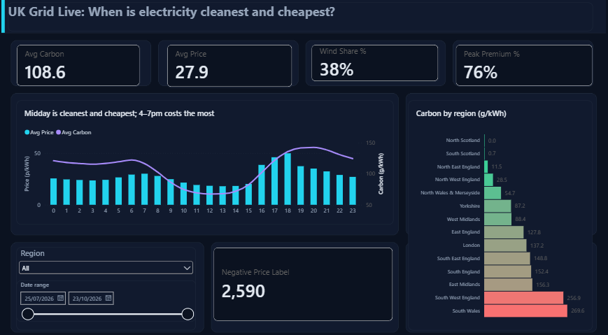
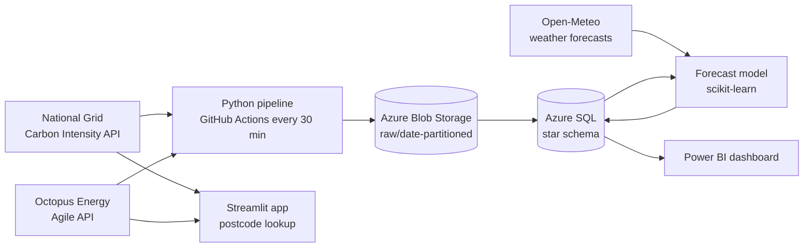
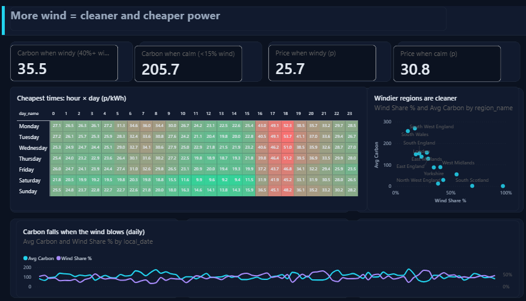
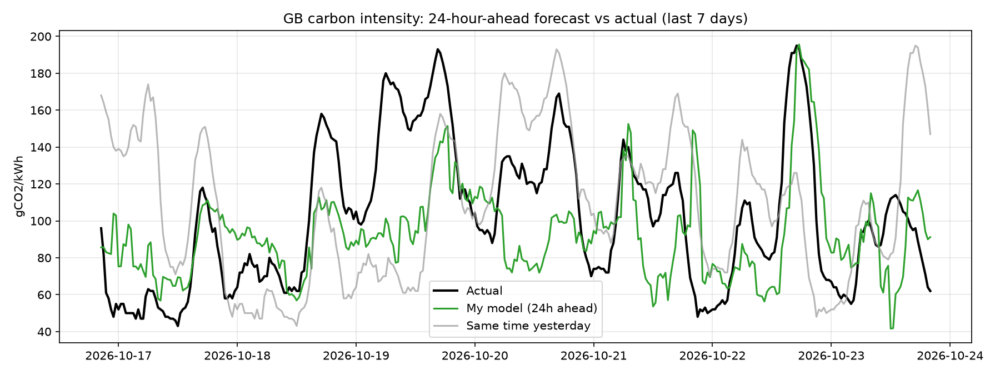

# ⚡ UK Grid Live

**When is electricity cleanest and cheapest where you live?**

An end-to-end data platform that collects live UK grid carbon and electricity price data every 30 minutes, models it in Azure SQL, uncovers when and where power is greenest and cheapest, forecasts carbon intensity 24 hours ahead, and serves the answer to anyone through a public postcode web app.

🔗 **Live app:** https://uk-grid-live-zfo6nfumisxwv9rytv8yhn.streamlit.app/
📊 **Dashboard (PDF):** [docs/UK_Grid_Live_Dashboard.pdf](docs/UK_Grid_Live_Dashboard.pdf)



---

## The problem

UK electricity varies hugely in both **carbon** and **price** depending on *where* you are and *when* you use it. Octopus Agile customers pay a different price every half hour, and the grid can be almost carbon-free in one region while burning gas in another. Most people have no easy way to know the best time to charge a car or run the washing machine.

## What I built

| Layer | What it does | Tools |
|---|---|---|
| **Ingestion** | Pulls carbon intensity + generation mix for 18 regions and Agile prices for 14 regions every 30 minutes | Python, REST APIs, GitHub Actions (cron) |
| **Data lake** | Stores raw JSON, partitioned by date | Azure Blob Storage |
| **Backfill** | Loaded 90 days of history for analysis and modelling | Python, pandas |
| **Warehouse** | Star schema with integrity constraints | Azure SQL Database, SQLAlchemy |
| **Quality** | Automated checks for duplicates, gaps, mix totals and ranges | SQL |
| **Analysis** | 7 business questions answered in SQL | T-SQL |
| **Forecast** | 24-hour-ahead carbon forecast using weather forecasts | scikit-learn |
| **BI** | 3-page dashboard | Power BI (DAX) |
| **App** | Public postcode lookup with best-time planner | Streamlit, Altair |

## Architecture



## Data model

```
              dim_datetime (4,321)            dim_region (18)
              datetime_key, local_hour,       region_id, region_name,
              settlement_period, day_name...  octopus_code, region_level
                    │            │                   │
        ┌───────────┘            └──────────┐        │
        ▼                                   ▼        ▼
  fact_national (4,321)               fact_grid (77,778)
  NG forecast + actual carbon         carbon, generation mix, Agile price
                                      per region per half hour

  forecast_results (672)  ← model output for the 14-day test window
```

- 1 row per region per half hour (90 days × 48 periods × 18 regions = 77,778)
- Composite primary key (`datetime_key`, `region_id`) and foreign keys enforced in Azure SQL
- UTC keys with Europe/London local time attributes, so analysis respects BST/GMT

## Data quality

| Check | Result |
|---|---|
| Duplicate keys | 0 |
| Missing half-hours | 0 of 4,321 |
| Generation mix not summing to 100% (±1) | 0 |
| Carbon values out of range | 0 |
| Missing prices | 14, all at the first half-hour (carbon API returns one period before the requested start; boundary effect) |
| Missing national actual | 1, the latest period not yet measured |
| Negative prices | 2,590, kept on purpose: real Agile behaviour |

## Key findings (90 days, Jul–Oct 2026)

1. **Location matters most.** North Scotland averaged **0 gCO2/kWh**, South Wales **270** and South West England **257**.
2. **Midday is the sweet spot.** 12–2pm is the cleanest (67 g) and among the cheapest (18p) time of day. Shifting usage from **6pm to 1pm cuts price by 64% and carbon by 50%**.
3. **The 4–7pm peak costs 76% more** (44.8p vs 25.5p).
4. **Wind drives everything.** Windy half-hours (40%+ wind) averaged **36 g vs 206 g** when calm (nearly 6× cleaner) and were 17% cheaper.
5. **Weekends are 20% cheaper and 13% cleaner** than weekdays.
6. **Cheap is not always clean.** Price and carbon correlate only weakly (r = 0.25), so a carbon signal adds information beyond price.
7. **You can get paid to use power.** 2,590 regional half-hours had negative prices, down to −5.5p/kWh.



## Forecast: can we predict tomorrow's carbon?

A gradient boosting model forecasts national carbon intensity **24 hours ahead** using only information available a day before: offshore wind speed forecasts (Dogger Bank, Irish Sea, Aberdeen), solar radiation and temperature forecasts, time of day, day of week, and carbon from 1, 2 and 7 days earlier. Trained on 75 days and tested on the most recent 14.

| Method | MAE (gCO2/kWh) |
|---|---|
| Naive: same time last week | 49.4 |
| Naive: same time yesterday | 38.8 |
| **My model (24h ahead + weather)** | **22.4** |
| National Grid (archived, updated up to delivery) | 10.1 |

**The model cuts error by 42% versus the same-time-yesterday baseline.** The top drivers are Dogger Bank and average wind speed, then time of day.

National Grid's archived forecast is revised right up to the half hour itself, so it is shown as a reference point rather than a like-for-like competitor to a forecast made a full day ahead.



## The app

Enter a postcode, choose an appliance (EV, dishwasher, washing machine...) and slide between **cheapest** and **greenest**. The app finds the best start time in the next 48 hours using live National Grid forecasts and Octopus Agile prices, and shows how much cleaner and cheaper it is than running it now.

## Repository structure

```
uk-grid-live/
├── .github/workflows/pipeline.yml   # runs every 30 minutes
├── .streamlit/config.toml           # app dark theme
├── app/
│   ├── streamlit_app.py             # public web app
│   └── requirements.txt
├── src/
│   ├── fetch_carbon.py              # National Grid API
│   ├── fetch_prices.py              # Octopus Agile API
│   ├── upload_raw.py                # Azure Blob upload
│   ├── pipeline.py                  # scheduled ingestion
│   ├── backfill.py                  # 90-day history
│   ├── load_sql.py                  # star schema load + checks
│   ├── run_sql.py                   # runs named SQL blocks
│   └── forecast.py                  # 24h-ahead model
├── sql/
│   ├── 01_schema.sql
│   ├── 02_quality_checks.sql
│   └── 03_analysis.sql
├── docs/
│   ├── findings.md
│   ├── UK_Grid_Live_Dashboard.pdf
│   └── images/
└── requirements.txt
```

## Run it yourself

```bash
git clone https://github.com/chshery/uk-grid-live.git
cd uk-grid-live
python -m pip install -r requirements.txt
```

Create a `.env` file:
```
AZURE_STORAGE_CONNECTION_STRING=...
SQL_SERVER=your-server-name
SQL_DB=gridlive
SQL_USER=...
SQL_PASSWORD=...
```

```bash
python src/backfill.py                          # 90 days of history -> Blob
python src/load_sql.py                          # star schema in Azure SQL
python src/run_sql.py sql/02_quality_checks.sql
python src/run_sql.py sql/03_analysis.sql
python src/forecast.py                          # model + chart
python -m streamlit run app/streamlit_app.py    # app locally
```

Requires ODBC Driver 18 for SQL Server. Everything runs on Azure free tiers.

## Limitations and next steps

- Regional carbon values are National Grid forecasts; actual measured values are only published nationally.
- 90 days covers summer to autumn, so winter demand patterns are not yet represented.
- Next: forecast at regional level, add demand data, and load new pipeline runs into Azure SQL incrementally.

## Data sources

- [Carbon Intensity API](https://carbonintensity.org.uk/), National Grid ESO / NESO (CC BY 4.0)
- [Octopus Energy API](https://developer.octopus.energy/) (public Agile tariff data)
- [Open-Meteo](https://open-meteo.com/) historical forecast API

---

**Built by Shaheer Ahmad** · [LinkedIn](https://www.linkedin.com/in/shaheer-ahmad-7698a7202/) · [GitHub](https://github.com/chshery)